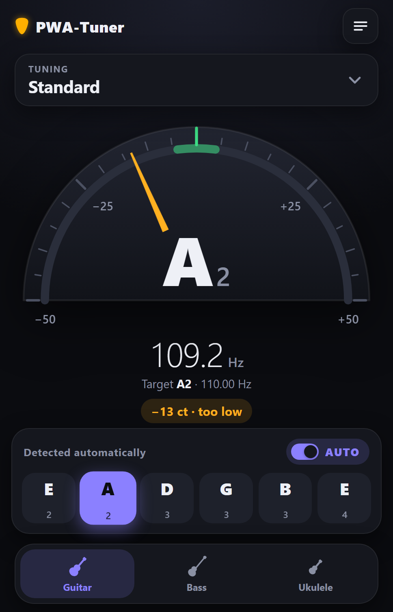
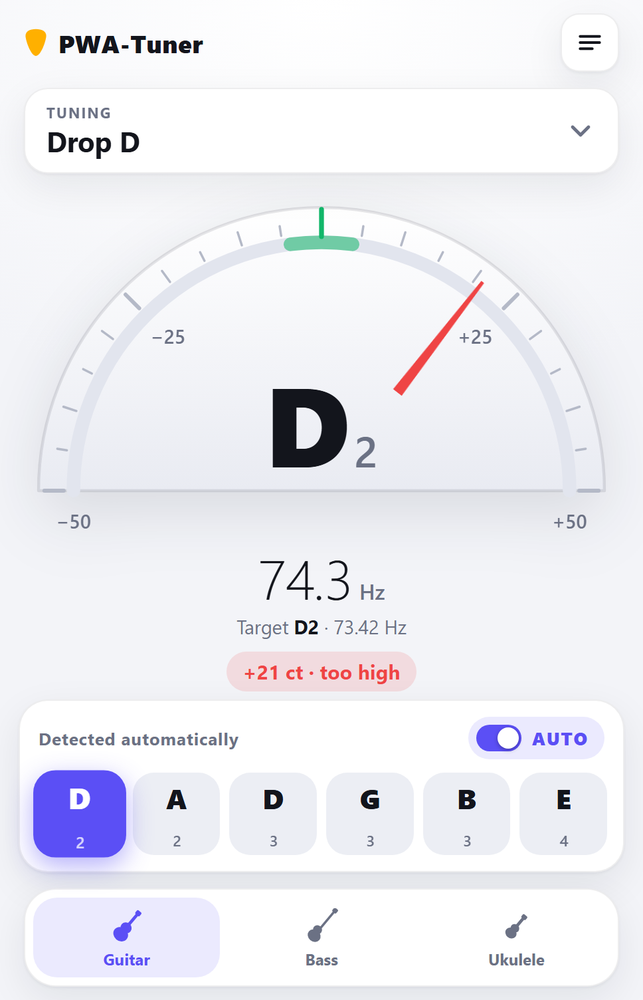
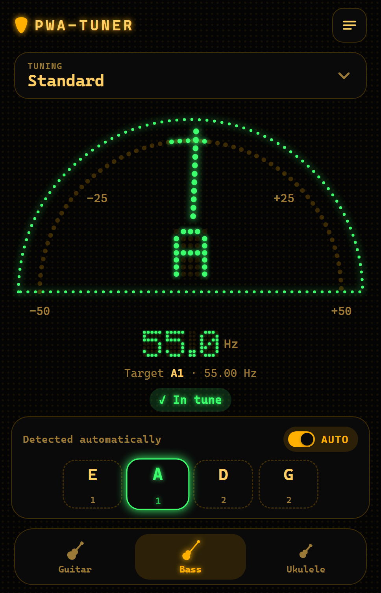

<p align="center">
  
</p>

<h1 align="center">PWA-Tuner</h1>

<p align="center">
  A chromatic instrument tuner for <b>guitar, bass and ukulele</b> that runs in the browser and installs as an app on your phone.
</p>

<p align="center">
  <a href="https://lumpenklumpen.github.io/pwa-tuner/"><b>Open PWA-Tuner</b></a>
  &nbsp;·&nbsp;
  <a href="CHANGELOG.md">Changelog</a>
  <br><br>
  <a href="https://github.com/Lumpenklumpen/pwa-tuner/actions/workflows/deploy.yml"></a>
  <a href="LICENSE"></a>
</p>

PWA-Tuner is a Progressive Web App written in plain HTML, CSS and JavaScript: no framework, no build step, no dependencies. After the first visit it works offline.

<p align="center">
  
  &nbsp;
  
  &nbsp;
  
</p>

## Features

- **Three instruments:** guitar (6 and 7 strings), bass (4, 5 and 6 strings) and ukulele.
- **80 tunings:** standard and down-tuned, Drop, Double Drop, Open major and minor in all common keys, DADGAD and sus4, and more. See [Tunings](#tunings).
- **Automatic string detection:** play any string and the tuner picks the matching one. You can also tap a string to lock it.
- **Precise meter:** a semicircle covering ±50 cents, with color coding: green within ±4 cents, amber within ±15 cents, red beyond.
- **Favorites:** star the tunings you use and they appear at the top of the list.
- **Three themes:** Light, Dark and LED. The LED theme draws the meter, needle and readout as glowing dots on a dot-matrix display.
- **Two languages:** English and German, switchable in the menu. Note names are always international (C D E F G A B).
- **Adjustable reference pitch:** A4 from 420 to 460 Hz (default 440 Hz).
- **Built for the phone:** works offline, installs to the home screen, and keeps the screen on while tuning.
- **Remembers your settings:** instrument, tuning per instrument, favorites, theme, language and reference pitch.

## Tunings

| Instrument | Tunings |
|---|---|
| **Guitar** | Standard; E♭, D, C♯, C, B, B♭, A Standard · Drop E♭, D, C♯, C, B, A♯, A, G♯, G · Double Drop D, C♯, C · Open E, E♭, D, C♯, C, B, B♭, F, F♯, G, A♭, A · Open E, E♭, D, C♯, C, G, A Minor · DADGAD and E♭/C♯/C sus4 · All Fourths, Open C6, New Standard (Fripp) · 7-string Standard (B), B♭, A Standard, Drop A, G♯, G |
| **Bass** | Standard; E♭, D, C♯, C, B Standard · Drop D, C♯, C, B, A♯, A · 5-string Standard (B), B♭, A Standard, Drop A, High C · 6-string Standard |
| **Ukulele** | Standard (C, High G), D, B♭ and B tuning · Low G, Low A, Low F · Baritone · Bass Ukulele (U-Bass) · Open C (Slack Key) |

Tunings are generated from interval patterns (for example Drop = 0, 7, 12, 17, 21, 26 semitones from the lowest string) applied to a list of root notes. Notes are spelled the way musicians expect: E♭ Standard uses B♭, not A♯, and Open E uses G♯.

## Getting started

Any static web server will do. With Python:

```bash
python -m http.server 8080 --bind 0.0.0.0
```

Open `http://localhost:8080` and tap **Start tuning**. Browsers only allow microphone access over HTTPS or on `localhost`.

### Using it on an Android phone

The easiest way is the hosted version: open <https://lumpenklumpen.github.io/pwa-tuner/> on your phone.

To use a development server on your PC from your phone, both devices need to be on the same network. Open `http://<your-PC-IP>:8080` on the phone. Chrome blocks the microphone and app installation on plain `http://` addresses, so mark the address as trusted:

1. On your phone, open `chrome://flags/#unsafely-treat-insecure-origin-as-secure` in Chrome.
2. Under **Insecure origins treated as secure**, enter the address exactly as you open it, including `http://` and the port, without a trailing slash. Example: `http://192.168.0.42:8080`.
3. Set the dropdown next to it to **Enabled**.
4. Tap **Relaunch**.

If your PC's IP address changes, you have to update the flag. A Chrome update can also reset flags. On Windows, the firewall may ask whether Python may accept connections; allow it for **private** networks.

### Installing as an app

Open the app in Chrome, then either tap **Install app** in the menu (shown when Chrome offers installation) or choose **Add to Home screen** from Chrome's menu. The installed app works offline.

## Development

### Tests

The tests use Node's built-in test runner and need no dependencies (Node 18 or later):

```bash
node --test tests/
```

They cover:
- **Pitch detection:** accuracy on synthetic string sounds from 31 Hz to 494 Hz, including a weak fundamental.
- **Tuning data:** valid notes, string counts, ascending strings, stable IDs and spelling.
- **Translations:** identical keys and placeholders in all languages, no missing or unused keys.
- **Offline cache:** every file listed in the service worker exists.
- **Release:** the version has the form `MAJOR.MINOR.PATCH`, the changelog has an entry for it, and every cached file is published.

### Project structure

| Path | Contents |
|---|---|
| `index.html` | Page markup |
| `css/style.css` | Layout and themes (CSS custom properties per `data-theme`) |
| `js/version.js` | The app version, used by the menu and the service worker |
| `js/app.js` | State, persistence (`localStorage`), tuning picker, meter, automatic string detection, wake lock |
| `js/pitch.js` | Pitch detection (YIN), independent of the browser so it can be tested in Node |
| `js/audio.js` | Microphone → `AnalyserNode` → YIN, about 25 measurements per second |
| `js/tunings.js` | Tuning definitions and note helpers |
| `js/i18n.js` | Loads translations, `tr(key, params)`, translates `data-i18n` attributes |
| `js/matrix.js` | 5×7 dot-matrix font for the LED theme |
| `locales/*.json` | Translations |
| `sw.js` | Service worker (offline cache) |
| `manifest.webmanifest` | App name, icons, display mode |
| `icons/` | App icons and logo (SVG sources and rendered PNGs) |
| `tests/` | Tests |
| `.github/workflows/deploy.yml` | Runs the tests and publishes to GitHub Pages |
| `CHANGELOG.md` | Changes per version |

### How the pitch detection works

`js/audio.js` reads about 170 ms of audio from the microphone, halves the sample rate (24 kHz is plenty for string instruments and makes detection about four times faster) and passes it to the YIN algorithm in `js/pitch.js`.
YIN finds the period of the signal through a cumulative normalized difference function, with parabolic interpolation for sub-sample accuracy. The search range is limited to the current tuning, from slightly below the lowest string to well above the highest.

`js/app.js` then smooths the result in three ways:
- a median over the last five readings removes outliers;
- an exponential moving average steadies the needle;
- hysteresis keeps the "in tune" state and the automatic string choice from flickering.

### Adding a language

1. Copy `locales/en.json` to `locales/<id>.json` and translate the values.
2. Add the language to `LANGUAGES` in `js/i18n.js`, with its name in that language, e.g. `{ id: 'fr', name: 'Français' }`.
3. Add the file to `FILES` in `sw.js`.
4. Add the language to `LANGS` in `tests/i18n.test.js`. The tests then check that no key or placeholder is missing.

### Adding a tuning

Add an entry to the instrument in `js/tunings.js`: either a new root note in an existing family, or a new `family(...)` or `single(...)`. Its name and group are translation keys, so add the matching text to every file in `locales/`.

Do not change the `id` of an existing tuning. IDs are stored on the user's device for the selected tuning and favorites. A test makes sure the original IDs still exist.

### Updates and caching

The service worker answers from its cache first and fetches the new version in the background (stale-while-revalidate). A change therefore shows up on the **second** reload. The cache is named after the app version, so a new release replaces the old cache. When you add or remove files, update `FILES` in `sw.js`.

## Deployment

Every push to `main` runs the [Test and deploy](.github/workflows/deploy.yml) workflow. It runs the tests and, only if they pass, publishes the app to GitHub Pages. Pull requests are tested but not published.

## Releasing a new version

PWA-Tuner uses [Semantic Versioning](https://semver.org/):
- **patch** (1.0.1) for fixes;
- **minor** (1.1.0) for new features such as tunings or languages;
- **major** (2.0.0) for changes that break something, such as stored settings that are no longer compatible.

1. Set the new version in `js/version.js`.
2. In `CHANGELOG.md`, move the entries from *Unreleased* into a new section for the version.
3. Commit, tag and push:

   ```bash
   git commit -am "Release v1.1.0"
   git tag v1.1.0
   git push origin main --tags
   ```

4. Create a GitHub release for the tag, using the changelog section as release notes:

   ```bash
   gh release create v1.1.0 --title "v1.1.0" --notes-file <(awk -v h="## [1.1.0]" 'index($0, h) == 1 {f=1; next} /^## / || /^\[.*\]: / {f=0} f' CHANGELOG.md)
   ```

The version is shown at the bottom of the menu, so you can check on your phone which version is running.

## Contributing

Contributions are welcome. Fork the repository, make your change on a branch, run `node --test tests/` and open a pull request. Please add an entry under *Unreleased* in `CHANGELOG.md`.

## Browser support

Tested with Chrome and Edge, and Chrome on Android. The app needs `getUserMedia` and the Web Audio API, which all current browsers support. Installation and keeping the screen on depend on browser support for web app manifests and the Screen Wake Lock API.

## License

[MIT](LICENSE)
